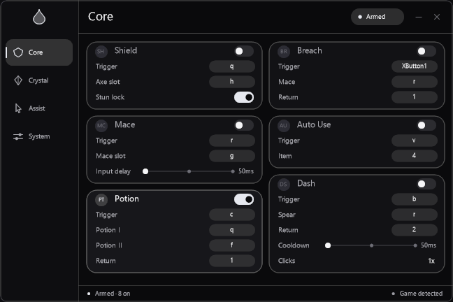

# Hydrogen

[Website](https://site-f9270d9239294ae0b43816a6d295ef6a.freebuff.page)

Hydrogen is a low-latency, zero-dependency Rust macro suite for Windows and
Minecraft Java. It runs as a tray-native overlay and injects only synthetic
keyboard/mouse input; it does not read or modify game memory.



## Features

- Anchor: place, charge once, switch off glowstone, detonate. The three slots
  must be distinct and each step keeps the 50 ms tick floor.
- Sprint: while physical W is held, pulse the sprint binding once per second.
  The key is never held down between pulses, and the watcher is lock-free.
- W-Tap: S-Tap by default with a 132–148 ms timing window. Existing configs
  using the old W / 100–120 ms default pair migrate once.
- Crystal, Mace, Dash, Shield, Potion, Pearl, Totem, Breach, Fast Use, Auto Use,
  and Hover Inventory are one-shot actions with per-module busy guards.
- 648x432 acrylic panel, event-driven rendering, Low Latency mode, adaptive
  local timing, an optional offline combat timing profile, and AHK-compatible
  INI migration.
- Portable x64 executable plus a signed full-trust MSIX package.
- The panel is visible to screen capture and streaming tools. There is no
  capture exclusion, streamproof mode, process hiding, or disguise behavior.

## Combat timing profile

`tools/combat-lab.ps1` turns timestamped, human-confirmed hits from combat
footage into a compact local timing prior. `tools/combat-annotator.html` is a
local-only video page that exports the CSV; it never uploads the clip. Hydrogen
reads `%LOCALAPPDATA%\Hydrogen\combat.profile` once at startup, blends it with
the local cadence brain, and clamps it to the configured Min/Max. Delete the
file to disable it. The runtime never reads video or the network.

See [docs/COMBAT_LAB.md](docs/COMBAT_LAB.md) for the CSV contract and safety
rules, and [docs/AI.md](docs/AI.md) for the research boundary.

## Deliberate boundaries

Hydrogen is designed to stay small, auditable, and predictable:

- No crates, network calls, telemetry, updater, or runtime downloader.
- No camera, WebView, game-memory access, or external AI/LLM integration.
- Vision is limited to the existing 1x1 magenta crosshair sample used by the
  totem watcher.
- Input hooks and the safety gate stop macros when focus leaves Minecraft (or
  when focus-only mode is disabled).
- No process hiding, scan evasion, self-erasure, or disguised executable.
- No screen-capture concealment. The overlay is ordinary visible desktop
  composition.

## Distribution

Hydrogen is proprietary software. The source code, build scripts, internal
engineering notes, and non-public assets are not distributed, and no public
source download is provided. The versioned executable is the product. See
[LICENSE](LICENSE).

The public product page is static documentation and media, not a source
repository. It has no analytics, external fonts, client-side JavaScript, or
network calls. Its source lives locally in `site/`, and the Freebuff Sites
project ID is recorded in `site/SITE_ID.txt`.

## Development

These commands are for the private development checkout:

```bash
rustup target add x86_64-pc-windows-gnu
cargo test --release
cargo build --release
```

The release profile uses `opt-level = 3`, fat LTO, one codegen unit, aborting
panics, and stripped symbols. The project targets
`x86_64-pc-windows-gnu` via `.cargo/config.toml`.

## Package and install

```powershell
powershell.exe -NoProfile -ExecutionPolicy Bypass -File scripts/build-msix.ps1
```

The script stages the manifest/assets/payload, packs and signs the MSIX with the
project-local signing tools, and writes the portable executable to
`apps/Hydrogen/Hydrogen.exe`. `Install-Hydrogen.cmd` installs the package and
launches it from the Start menu.

The development certificate is self-signed. Installing the package on another
machine requires trusting that certificate in `LocalMachine\TrustedPeople`.

## Configuration

Settings live in `%LOCALAPPDATA%\Hydrogen\config.ini`. Existing AHK
`%TEMP%\settings.dat` files are imported once using the same `v0`/`v6` key
names. Config writes are atomic and an invalid slot combination or an inactive
master/focus gate prevents injection.

## Verification

- `cargo test --release`: 12 tests covering config migration, timing bounds,
  Anchor slot validation, W-Tap defaults/planning, Sprint scheduling, and
  combat-profile parsing.
- Anchor input trace: `h,g,r` for the default place, charge, and detonate steps.
- Release binary: `582,144` bytes, down from `604,672` bytes in 2.3.8.
- Source and installed package: `2.4.0` / `2.4.0.0`; the rebuilt MSIX signature
  verified with the local development certificate.

Real in-game hit registration still needs verification in a live Minecraft
client; input injection and timing are verified independently.

## License

Proprietary. See [LICENSE](LICENSE). No source code is distributed.
