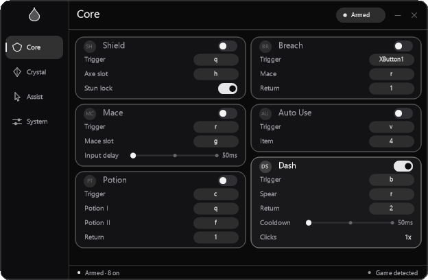

# Droplet

[Website](https://site-f9270d9239294ae0b43816a6d295ef6a.freebuff.page) · [Source](https://github.com/fuvji/droplet) · [Benchmarks](BENCHMARKS.md) · [Sponsors](SPONSORS.md)

Droplet is a low-latency, zero-dependency Rust macro suite for Windows and
Minecraft Java. It runs as a tray-native overlay and injects only synthetic
keyboard/mouse input; it does not read or modify game memory.

## About

Droplet is a compact, local Minecraft macro suite for Windows, written in Rust.
It is built for players who want exact, repeatable input sequences without
game-memory reads, network calls, or telemetry. The panel and every action stay
visible to ordinary screen capture.



## Features

- Pre-indexed trigger routing: bindings are parsed when settings publish, then
  the low-level hook resolves an event with one array read instead of scanning
  up to 24 binding strings. The release microbenchmark is 0.45 ns versus
  202.39 ns for the old route, a 445× reduction in the routing decision alone.
- Anchor: place, charge once, switch off glowstone, detonate. The three slots
  must be distinct and each step keeps the 50 ms tick floor. 2.6.0 removed two
  duplicated waits from the normal path, shortening it by 100 ms.
- Sprint: while physical W is held, pulse the sprint binding every 100 ms. The
  key is never held down between pulses; the watcher is lock-free and samples
  every 8 ms so the deadline is not rounded up by a coarse poll.
- W-Tap: S-Tap by default with a 132–148 ms timing window. Existing configs
  using the old W / 100–120 ms default pair migrate once.
- The local cadence brain uses a warm-up EWMA: early activations adapt quickly,
  then the step floor settles at 12.5%, always inside the configured Min/Max.
- System > Behaviour reports `Capture: Visible`. There is no streamproof or
  capture-evasion mode.
- Crystal, Mace, Dash, Shield, Potion, Pearl, Totem, Breach, Fast Use, Auto Use,
  and Hover Inventory are one-shot actions with per-module busy guards.
- 624×408 acrylic panel, event-driven rendering, Low Latency mode, adaptive
  local timing, an optional offline combat timing profile, and AHK-compatible
  INI migration.
- Portable x64 executable plus a signed full-trust MSIX package.
- The panel is visible to screen capture and streaming tools. There is no
  capture exclusion, streamproof mode, process hiding, or disguise behavior.
- The public product page uses a monochrome graphite/white acrylic system with
  measured routing facts, a pipeline model, native capture previews, a silent
  four-tab UI reel, an audit, specs, and direct sponsor inventory.

## Performance

The trigger-routing benchmark measured in 2.6.0 is documented in
[BENCHMARKS.md](BENCHMARKS.md). It measures the routing decision only:

| Path | Time |
| --- | ---: |
| Binding scan (2.4.1) | 202.39 ns |
| Pre-indexed route (2.5.0+) | 0.45 ns |
| Reduction | 445× |

This is not a zero-latency claim and not an end-to-end input or game-latency
measurement. Minecraft observes input on a 50 ms tick. The reduced work is in
Droplet's own hook path.

## Combat timing profile

`tools/combat-lab.ps1` turns timestamped, human-confirmed hits from combat
footage into a compact local timing prior. `tools/combat-annotator.html` is a
local-only video page that exports the CSV; it never uploads the clip. Droplet
reads `%LOCALAPPDATA%\Droplet\combat.profile` once at startup, blends it with
the local cadence brain, and clamps it to the configured Min/Max. Delete the
file to disable it. The runtime never reads video or the network.

See [docs/COMBAT_LAB.md](docs/COMBAT_LAB.md) for the CSV contract and safety
rules, and [docs/AI.md](docs/AI.md) for the research boundary.

## Deliberate boundaries

Droplet is designed to stay small, auditable, and predictable:

- No crates, network calls, telemetry, updater, or runtime downloader.
- No camera, WebView, game-memory access, or external AI/LLM integration.
- Vision is limited to the existing 1×1 magenta crosshair sample used by the
  totem watcher.
- Input hooks and the safety gate stop macros when focus leaves Minecraft (or
  when focus-only mode is disabled).
- No process hiding, scan evasion, self-erasure, or disguised executable.
- No screen-capture concealment. The overlay is ordinary visible desktop
  composition.
- No anti-cheat bypass, input laundering, or zero-latency mode.

## Distribution

Droplet is proprietary software. The source is published at
<https://github.com/fuvji/droplet> for transparency and inspection. Public
availability does not make Droplet open source: no licence is granted to copy,
modify, redistribute, or sublicense the source. The versioned executable remains
the supported product. See [LICENSE](LICENSE).

The public product page is static documentation and media. Its source is
published in the same repository. It has no analytics, external fonts,
client-side JavaScript, third-party ad scripts, or network calls. It includes a
four native panel captures, CSS motion, a benchmark chart, a runtime model, and
an explicit capture-lab note. The site includes a direct sponsor inventory at
`site/public/sponsors.html`; sponsor links are ordinary outbound navigation.
The Freebuff Sites project ID is recorded in `site/SITE_ID.txt`.

## Development

These commands are for the development checkout:

```bash
rustup target add x86_64-pc-windows-gnu
cargo test --release
cargo build --release
```

The release profile uses `opt-level = 3`, fat LTO, one codegen unit, aborting
panics, and stripped symbols. The project targets
`x86_64-pc-windows-gnu` via `.cargo/config.toml`. The repository's
[development guide](DEVELOPING.md) covers packaging, site preview, and the
security model. The website is a pair of static HTML pages with a shared CSS
file, local images, no JavaScript, no external fonts, and no third-party
requests. Its worker adds a strict CSP and asset-aware cache headers.

### Local site preview

The static page has a dependency-free preview server for the private checkout:

```powershell
powershell.exe -NoProfile -ExecutionPolicy Bypass -File tools/serve-site.ps1
```

Open <http://127.0.0.1:4173/>. The server binds loopback only and is not part of
the deployed site; production uses the manifest in `site/deploy.json`.

## Package and install

```powershell
powershell.exe -NoProfile -ExecutionPolicy Bypass -File scripts/build-msix.ps1
```

The script stages the manifest/assets/payload, packs and signs the MSIX with the
project-local signing tools, and writes the portable executable to
`apps/Droplet/Droplet.exe`. `Install-Droplet.cmd` installs the package and
launches it from the Start menu.

The development certificate is self-signed. Installing the package on another
machine requires trusting that certificate in `LocalMachine\TrustedPeople`.

## Configuration

Settings live in `%LOCALAPPDATA%\Droplet\config.ini`. Existing AHK
`%TEMP%\settings.dat` files are imported once using the same `v0`/`v6` key
names. Config writes are atomic and an invalid slot combination or an inactive
master/focus gate prevents injection.

## Verification

- `cargo test --release`: 14 tests covering config migration, timing bounds,
  Anchor slot validation, W-Tap defaults/planning, Sprint scheduling,
  cadence-brain warm-up, combat-profile parsing, and trigger-index
  equivalence/benchmarking.
- Trigger routing benchmark: 0.45 ns indexed versus 202.39 ns scanned; 445×
  reduction in the routing lookup. See [BENCHMARKS.md](BENCHMARKS.md).
- Anchor input trace: `h,g,r` for the default place, charge, and detonate steps.
- Release binary: `581,632` bytes, `264096e17917010b500bb971ae88dd868d8b4d2cc8369c009d4aa435872422c5`.
- Signed MSIX: `305,682` bytes, `34ba5f4ec57651fcca40cbce7111b8403efaa63bb77a50c47b838e005ea60770`;
  signed with the local Droplet development certificate. A fresh machine needs
  that leaf in `LocalMachine\TrustedPeople`, which `Install-Droplet.cmd` does
  with a one-time UAC prompt.
- Sprint deadline: 100 ms, asserted by `sprint_pulses_every_hundred_ms`; the
  watcher polls every 8 ms so the deadline is not rounded up by the timer.
- Source and package: `2.6.2` / `2.6.2.0`.
- Four native 624×408 tab captures live in `site/public/assets/droplet-{core,crystal,assist,system}.png`.

Real in-game hit registration still needs verification in a live Minecraft
client; input injection and timing are verified independently. The site does
not publish fabricated gameplay footage.

## Sponsors

The direct sponsor inventory is in [SPONSORS.md](SPONSORS.md) and
`site/public/sponsors.html`. There is no ad network, no tracking, and no
self-serve insertion. Open an inquiry through the GitHub issue link on the
sponsor page.

## License

Proprietary. See [LICENSE](LICENSE). The source is public for inspection, but
public availability is not an open-source grant.
