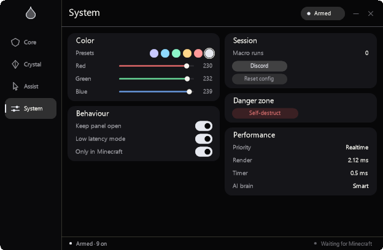

<div align="center">


# droplet

**Minecraft Zero Macro** — a local, visible Windows input macro suite.

[Website](https://fuvji.github.io/droplet/) · [Downloads](https://fuvji.github.io/droplet/#download) · [Releases](https://fuvji.github.io/droplet/releases.html) · [Benchmarks](BENCHMARKS.md) · [Source](https://github.com/fuvji/droplet)

</div>

Droplet runs exact keyboard-and-mouse sequences for Minecraft Java, entirely
on your machine. It reads no game memory, makes no network calls, and ships no
telemetry. The panel and every action remain visible to ordinary screen
capture.

## Download

| Platform | Package | Size | Status |
| --- | --- | ---: | --- |
| Windows 10/11 x64 | [Portable exe](https://fuvji.github.io/droplet/downloads/droplet.exe) | 542,720 B | **Available** |
| Linux | — | — | Port not started; the core is Win32/GDI+ |
| macOS | — | — | Port not started; no Cocoa/Quartz layer |

Verify with [SHA256SUMS.txt](https://fuvji.github.io/droplet/downloads/SHA256SUMS.txt).
The single executable is unsigned. There is no MSIX/AppX, installer, or ZIP
package. No Linux `.deb`/AppImage/`.tar.gz` or macOS `.dmg`/`.zip`/`.img` is
published because those builds do not exist.

## What is in 2.10.8

- **Smaller binary (2.10.8)**: the one `std::process::Command` user, the
  self-destruct recycle waiter, now launches through the existing hidden
  `ShellExecuteW` path instead of linking std's process spawner. LLD plus ICF
  supplies the final link. The executable is 542,720 bytes, 55,808 smaller
  than 2.10.7 and 54,272 below the 596,992-byte target. Tests are 26 / 26.
- **Measured gating (2.10.8)**: a 60 s isolated run of 2.10.7 measured
  31.25 ms idle versus 125 ms armed CPU, with sprint-thread context switches
  at 9/s versus 126/s. The 2.10.8 build kept the same low CPU range and the
  same event-gated reads. These are short samples, not a speedup claim.
- **Event-gated armed reads (2.10.7)**: the sprint watcher checks the pulse
  deadline before cloning settings, so a held W causes at most one settings
  read per 100 ms instead of one every 8 ms. The crosshair watcher samples the
  cursor first and reads settings only on a magenta flash instead of every
  16 ms. The polling cadence and bindings are unchanged.
- **Idle poll floor (2.10.6)**: the sprint watcher parks for 100 ms while
  inactive instead of waking every 8 ms; focus and settings changes unpark it
  immediately. The armed cadence remains 8 ms. This cut scheduled idle polls
  from about 125/s to 10/s. The 2.10.6 binary was 1,536 bytes larger than
  2.10.5; the 2.10.8 size pass is separate.
- **Idle watcher gates**: the sprint and crosshair watchers cache their enable
  flags, so inactive loops skip the settings snapshot and its lock. The 8 ms /
  100 ms cadence and sprint reset behavior are unchanged.
- **Transparent brand mark**: the favicon tile is gone, and the site brand mark
  is one 27 px transparent rule with no plate, border, background, or shadow.
  The duplicate logo reset CSS is removed too.
- **Leaner presence loop**: the focus-only gate is cached in an atomic updated
  when settings publish, so the 160 ms presence loop no longer clones the
  settings snapshot or takes its lock.
- **Click-through corners**: DWM's antialiased clip now owns the edge, and the
  transparent quarter-rounds return `HTTRANSPARENT` instead of swallowing
  clicks. The center and straight edges still hit the panel; the hard-region
  fallback is unchanged.
- **Less redundant presence work**: once the foreground window is the verified
  game, the watcher reuses that HWND instead of resolving its process image
  every 160 ms. Presence, focus, and the cold-discovery scan are unchanged.
- **Cleaner corners**: Windows 11 now uses DWM's compositor-rounded, antialiased
  corner. The GDI region is only a fallback when DWM cannot round the popup, so
  the window is no longer clipped twice.
- **Game detection fixed**: a visible window is no longer enough. Droplet
  resolves the owning process and accepts only `javaw.exe`, `java.exe` with a
  game signature, or `Minecraft.Windows.exe`. Browsers, Discord, editors, and
  the launcher are rejected. Two samples are required before the badge says
  **Game detected**.
- **Anchor ported from Hydrogen**: the literal `A6` order is kept: select
  Anchor, right-click, 37–43 ms, right-click, Glowstone, 37–43 ms, double
  Totem tap, configured wait, right-click. Anchor sliders expose **47–97 /
  53–103 ms** and ship at **47/53**. The **Air loop** switch restores Hydrogen's
  held-repeat behavior.
- **One portable exe**: MSIX/AppX, installer, and ZIP packaging are gone. The
  release is a single unsigned `droplet.exe` plus checksums.
- **8 px shared corner**: paint, fallback region, DWM clip, and capture mask
  agree on the radius. There is no top accent strip or painted rim.
- **Independent sliders and knob switches** remain from 2.9.2.
- **No unrestricted-speed mode**. Other modules keep their configured delays;
  the game tick and Windows scheduling remain the real boundary.
- **Sticky hide**, same-frame Dash/Shield/Pearl input, the prebuilt trigger
  index, and the Self-destruct action are unchanged.

## GUI



The panel is a native 624×408 acrylic surface. One 8 px radius paints and
clips the window; DWM supplies the rounded edge, and there is no outer stroke
or top accent line.
Painting is event-driven; an idle panel does not schedule animation frames.
Binding and slot chips borrow their labels instead of allocating a `String` per
chip per frame.

## Modules

| Module | Sequence | Mode |
| --- | --- | --- |
| Anchor | Hydrogen A6: anchor, click, fixed settle, click, glowstone, totem, detonate; 47–97 / 53–103 ms | one-shot / Air loop |
| Auto Crystal | Obsidian, then crystal | one-shot / toggle |
| Mace | Settled swap and hit | one-shot / toggle |
| Shield | Axe select and hit in one batch; optional held stun | one-shot / toggle |
| Dash | Spear select, hit, restore; 50/100/150 ms cooldown | one-shot / toggle |
| Breach | Mace swap and return | one-shot / toggle |
| Potion | Two-slot drink and return | one-shot / toggle |
| Pearl | Pearl select and throw in one batch, then catch | one-shot / toggle |
| Hover Totem | Totem swap watcher | watcher |
| Fast Use | Bounded held right-click cadence | one-shot / toggle |
| Auto Use | Use an item, swap back | one-shot / toggle |
| W-Tap | S-Tap default, 132–148 ms | per-click |
| Sprint | One tap every 100 ms while physical W is held | bounded watcher |
| Ghost Click | Small local click offset, 1–12 px | per-click |
| Hover inventory | Peek without leaving combat | one-shot |

## Performance, without fairy tales

| Path | Time per lookup | Method |
| --- | ---: | --- |
| Old binding scan | 202.39 ns | Hash and scan up to 24 binding strings |
| Pre-indexed route | 0.45 ns | One array read from a prebuilt table |
| Routing reduction | 445× | Same event, process, and release profile |

This is a **routing microbenchmark**, not end-to-end input latency, game-tick
latency, or hit registration. Minecraft observes input on a 50 ms tick; Windows
and the device path add their own scheduling. “Zero” in the product name is a
name, not a latency claim. Details and reproduction:
[BENCHMARKS.md](BENCHMARKS.md).

## Verify

- `cargo test --release`: **26 / 26**.
- Portable executable: **542,720 bytes**,
  `d7648c2cad510014590fdbe578d14900d385cfab0d80a832b8a46989e1f41507`.
- Distribution: one direct `droplet.exe`; no MSIX/AppX, installer, or ZIP.
- Four native 624×408 captures in `site/public/assets/`.
- No live Minecraft client is available here. The no-game footer was verified
  from the 2.10.8 capture; live Anchor placement, Java/Bedrock positive
  detection, and hit registration remain unverified in game.

## Deliberate boundaries

Droplet is local and visible by design.

- No game-memory reads or writes.
- No network calls, telemetry, analytics, or silent auto-updater.
- No streamproof/capture-evasion mode, process hiding, scan evasion, log
  erasure, anti-cheat bypass, or input-device disguise.
- No zero-latency, “quantum speed”, “100% raw speed”, or “no restriction”
  claim. Droplet removes its own avoidable routing and redundant sleeps; it
  cannot remove the game loop, device path, or OS scheduler.
- The focus and master gates stop every macro when they are not satisfied.
- The portable exe is unsigned; SmartScreen may warn.
- Windows only for now. Linux and macOS require a real platform port, not a
  renamed archive.

## Build

```bash
rustup target add x86_64-pc-windows-gnu
cargo test --release
cargo build --release
```

The release is the single file at
`target/x86_64-pc-windows-gnu/release/droplet.exe`. Copy it to
`apps/droplet/droplet.exe` and `site/public/downloads/droplet.exe`. There is no
MSIX/AppX or installer step. See [DEVELOPING.md](DEVELOPING.md).

## Repository map

| Path | Contents |
| --- | --- |
| `src/` | Win32 shell, GDI+ paint, input hooks, macro modules, settings |
| `site/public/` | Static product site, release ledger, downloads, captures |
| `releases/` | Detailed per-version release notes |
| `docs/` | Combat-lab notes, AI boundaries, portable Obsidian vault |
| `.github/workflows/` | Tag-driven Windows release pipeline |
| `scripts/`, `tools/` | Captures, local preview, and release helpers |

The site uses one local script for OS detection on the download page. It sends
nothing and stores nothing. There are no third-party scripts, fonts, analytics,
or ad clients.

## Founder

Designed and built by [@epufk](https://github.com/epufk).

Not an official Minecraft product. Not approved by or associated with Mojang or
Microsoft. Minecraft is a trademark of Mojang Synergies AB.

## License

Proprietary. The source is public for inspection; public availability is not an
open-source grant. See [LICENSE](LICENSE).
